<picture>
  <source media="(prefers-color-scheme: dark)" srcset="./assets/header-dark.svg">
  <source media="(prefers-color-scheme: light)" srcset="./assets/header-light.svg">
  
</picture>

<p align="center">
  <a href="https://humayun1.vercel.app"></a>
  <a href="https://www.linkedin.com/in/humayunkabir13/"></a>
  <a href="mailto:humayunkabir6267@gmail.com"></a>
  <a href="https://humayun1.vercel.app/cv/CVofHK.pdf"></a>
</p>

I build full-stack web apps end to end: **React / Next.js** on the front, **Node.js + Express + MongoDB** on the back, and the parts in between that have to be right, like auth and roles, payments, caching, background jobs and data integrity.

I'm currently **open to full-stack or backend roles**.

| | |
|---|---|
| **Focus** | API design · React apps · Auth & RBAC · Payments · Caching · Scheduled jobs |
| **Production** | RentYard, Inc. (US, remote) · 150+ endpoints · 30+ Figma screens · 2 live apps |
| **Now** | Building a client finance system · learning PostgreSQL + Prisma |
| **Education** | B.Sc. in CSE, East Delta University (2024) |
| **Based in** | Bangladesh · GMT+6 · remote-ready |

---

## Experience

**Jr. Backend Developer** · RentYard, Inc. (Texas, US · Remote) · `Oct 2025 – Feb 2026`
- Built and maintained **150+ REST endpoints** for a production property rental platform.
- Designed one standard API response shape, which cut frontend integration time by **~20%**.
- Added Redis caching and `node-cron` background jobs, improving response time by **~10%** and removing manual recurring work.
- Agreed API contracts with frontend engineers early in each sprint, so integration issues dropped.

**Front-End Intern · Next.js / React** · RentYard, Inc. (Remote) · `Jul 2025 – Sep 2025`
- Shipped features on **2 live apps**, [rentyard.com](https://rentyard.com/) and [influencercave.com](https://influencercave.com/).
- Turned **30+ Figma screens** into responsive Next.js + TypeScript components.
- Wired **20+ API endpoints** with Axios + TanStack Query, cutting repeat network calls by **5–10%**.
- Finished with a Certificate of Completion and a Letter of Recommendation, then moved to the backend team.

---

## Featured work

| Project | What it is | The hard part | Links |
|---|---|---|---|
| **SomitiKhata** · client, in progress | Finance and ledger system for a cooperative of ~400–500 members. Deposits, savings, loans, land shares, yearly profit. | Real money rules in code: yearly profit split by net saving with a cap for low savers, loans up to 80% of savings, withdrawals up to 95%. Fiscal-year transaction numbers (`DEP-2025-26-000123`), MongoDB transactions on every multi-write, access + refresh tokens in httpOnly cookies, full Bangla + English. | Private (client) |
| **ERP: Inventory & Sales** | Role-based inventory and sales system. **23+ APIs across 5 modules.** | Atomic MongoDB transactions with rollback when stock or price checks fail, so prices can't be tampered with. 3-tier RBAC on both client and server, with the UI changing by permission. Passport local + Google OAuth with JWT refresh-and-retry in Axios. | [Live](https://erp-ims-client.vercel.app) · [Client](https://github.com/Humayun1318/erp-ims-client) · [Server](https://github.com/Humayun1318/ERP-Inventory-Sales-Management-System) |
| **Expense Tracker** | Personal finance platform. **25+ APIs across 5 modules, 11 dashboard pages.** | Daily `node-cron` processor for recurring transactions. It writes atomically and moves the schedule forward only after a successful write, so a failed run retries itself. Admin can trigger the job manually. | [Live](https://finance-tracking-client.vercel.app) · [Client](https://github.com/Humayun1318/web-development-bootcamp-may-2026/tree/main/Humayun1318/Frontend) · [Server](https://github.com/Humayun1318/web-development-bootcamp-may-2026/tree/main/Humayun1318/Backend) |
| **QuickHire ERP** | Enterprise job marketplace ERP. Seekers, companies, team members, job categories, listings. | Self-referencing job category tree with depth validation. 7+ modules on one strict module pattern, with full architecture docs. | [Code](https://github.com/Humayun1318/QuickHire) · [Docs](https://humayun1318.github.io/QuickHire_ERP_Architect_Doc) |
| **Trendora** · team project | Marketplace to buy, sell and swap second-hand goods. **15+ features.** | Next.js 15 client with a separate Express API, custom JWT auth and admin RBAC, multi-filter real-time search. | [Live](https://trendora-black.vercel.app/) · [Client](https://github.com/Humayun1318/trendora) · [Server](https://github.com/Humayun1318/SwapNest-server) |

<details>
<summary><b>More projects</b></summary>
<br>

| Project | What it is | Links |
|---|---|---|
| **Papyrus** | Stationery e-commerce with admin dashboard, RBAC and ShurjoPay payments. | [Live](https://papyrus-client.vercel.app/) · [Code](https://github.com/Humayun1318/papyrus-stationery-e-commerce) |
| **FutureEdge** | Career counseling platform with Firebase email/Google auth and protected routes. | [Live](https://futuredge-784af.web.app/) · [Code](https://github.com/Humayun1318/FuturEdge) |

</details>

---

## How I structure a backend

Every feature is a self-contained module with the same 7 files, so any developer can find anything in seconds. I wrote a small CLI that generates this skeleton from one command.

```text
src/modules/jobListing/
├── jobListing.constants.ts    # enums, searchable fields
├── jobListing.interface.ts    # TypeScript types
├── jobListing.model.ts        # Mongoose schema + indexes
├── jobListing.validation.ts   # Zod request schemas
├── jobListing.service.ts      # business logic, DB access
├── jobListing.controller.ts   # thin: request in, response out
└── jobListing.route.ts        # routes + auth/role guards
```

Controllers stay small. Errors go to one global handler, so there is no `try/catch` repeated in every file:

```ts
const createJobListing = catchAsync(async (req, res) => {
  const result = await JobListingServices.createJobListing(req.user, req.body);
  sendResponse(res, { statusCode: 201, message: "Job listing created", data: result });
});

export const JobListingControllers = { createJobListing };
```

---

## Stack

<p>
  <a href="https://skillicons.dev"></a>
</p>

| | |
|---|---|
| **Frontend** | React 19 · Next.js (App Router) · Redux Toolkit · RTK Query · TanStack Query · React Hook Form · Tailwind CSS · shadcn/ui |
| **Backend** | Node.js · Express · MongoDB / Mongoose · Redis · Zod · node-cron · Cloudinary |
| **Auth** | JWT (access + refresh) · Passport.js · Google OAuth 2.0 · RBAC |
| **Payments** | Stripe · SSLCommerz · ShurjoPay |
| **Learning** | PostgreSQL · Prisma |
| **Also** | C · C++ · Firebase · Git · Postman · Vercel · Figma |

---

## Right now

- Building **SomitiKhata** for a real client: Next.js frontend + Express/MongoDB backend.
- Learning **PostgreSQL + Prisma** past the basics.
- Building **QuickHire ERP** module by module.
- Solving DSA problems daily on [LeetCode](https://leetcode.com/u/humayun_kabir1/) and [Codeforces](https://codeforces.com/profile/humayunkabir6267).

---

## Outside code

Core member of **Atiyar Para Young Star Club** since 2016. It's a registered non-profit in Lohagara, Chattogram, where I help run community, education and sports events.

---

## Activity

<p align="center">
  
</p>

<p align="center">
  <sub>Open to full-stack / backend roles · <a href="mailto:humayunkabir6267@gmail.com">humayunkabir6267@gmail.com</a></sub>
</p>
